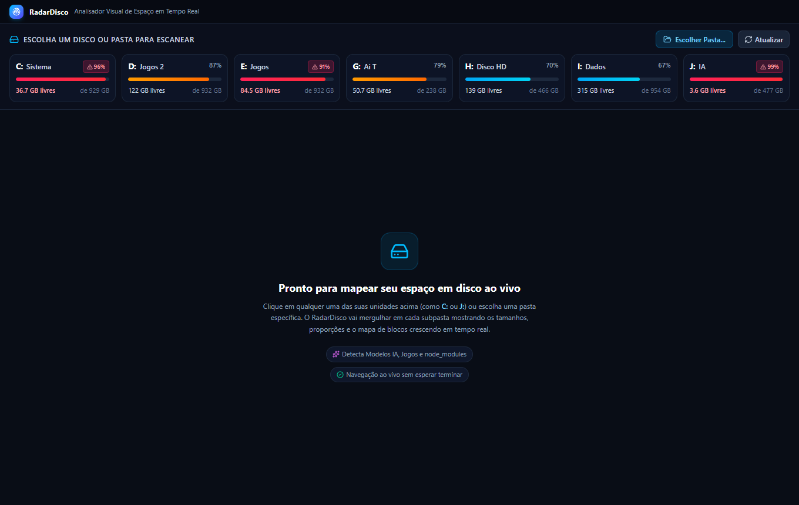
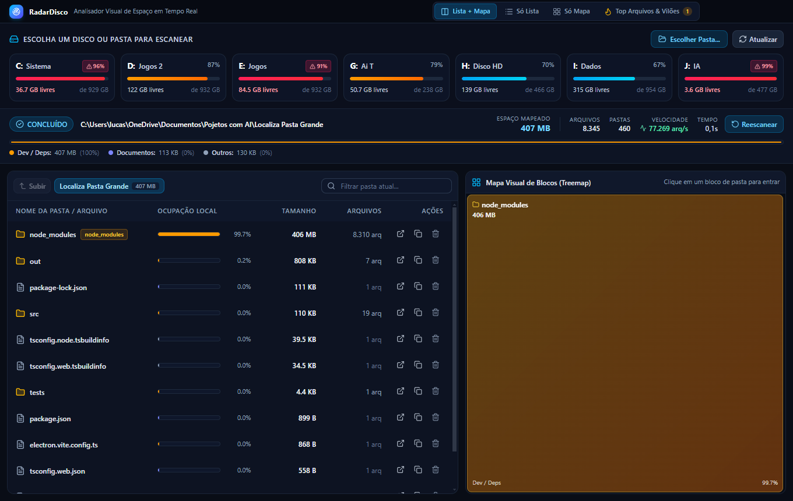
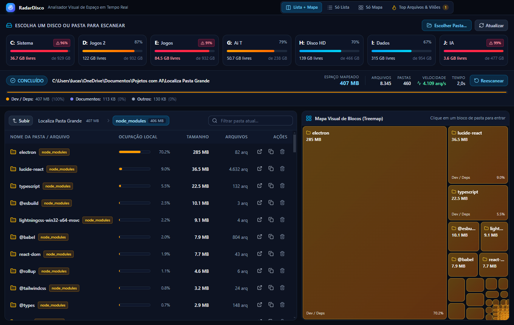

# RadarDisco — Analisador Visual de Espaço em Disco em Tempo Real com IA

Aplicativo desktop moderno para Windows construído com **Electron + Node.js + React + TypeScript + Tailwind CSS** para identificar pastas e arquivos gigantes em tempo real, visualizar proporções em um **Mapa de Blocos (Squarified Treemap)** e consultar um **Consultor de IA** (Google Gemini ou IA Local via Ollama / LM Studio) sobre o que pode ser apagado com segurança.

---

## Capturas de Tela

### Painel de Unidades e Alertas de Capacidade


### Escaneamento Ao Vivo (Lista Proporcional + Treemap)


### Navegação *Drill-down* Interativa


---

## Principais Recursos

- **Monitoramento de Unidades do Windows:** Lista todas as partições (`C:`, `D:`, etc.) com nome do volume, espaço livre/total e alerta visual para discos críticos (>90%).
- **Motor de Varredura Ao Vivo (`worker_threads`):** Escaneia até 24 diretórios simultaneamente com `fs.opendir` e `fs.lstat` sem travar a interface (60 FPS), ignorando links simbólicos/*junctions* e sem acionar downloads automáticos do OneDrive.
- **Lista Proporcional + Squarified Treemap:** Visualização sincronizada com cores semânticas por categoria (Modelos de IA, Jogos/Apps, Mídia, `node_modules`/Dev, Compactados, Documentos).
- **Top 50 Maiores Arquivos & Vilões de Espaço:** Detecta automaticamente pastas pesadas como `node_modules`, `.venv`, caches (`pip`, `uv`, `DXCache`, `ShaderCache`, `Temp`) e pesos de modelos de IA (`.gguf`, `.safetensors`).
- **Consultor Híbrido de IA (Google Gemini + Ollama / LM Studio):**
  - Analisa o mapeamento pós-scan e classifica cada pasta/arquivo em **Seguro Apagar**, **Avaliar com Cuidado** e **Não Apagar (Risco de Problema)**.
  - Descarrega automaticamente o modelo local da memória (VRAM/RAM) ao finalizar a análise (`lms unload --all` no LM Studio e `keep_alive: 0` no Ollama).
- **Pesquisa Inteligente na Web:** Botão rápido em cada item que higieniza nomes de usuário do caminho e pesquisa a pasta/arquivo no navegador.
- **Exclusão Verificada (Lixeira ou Permanente):** Verifica no disco se a pasta foi removida e limpa item por item caso algum arquivo específico de cache esteja em uso pelo Windows.

---

## Download do Instalador (Windows x64)

Baixe o instalador **`RadarDisco-Setup-1.0.0.exe`** diretamente na aba [**Releases**](../../releases/latest) deste repositório.

---

## Como Executar em Desenvolvimento

```bash
# Instalar dependências
npm install

# Rodar em modo desenvolvimento (Electron + Hot Reload)
npm run dev

# Rodar testes automatizados e checagem de tipos
npm run typecheck
npm test

# Gerar o instalador para Windows (.exe)
npm run dist:win
```
